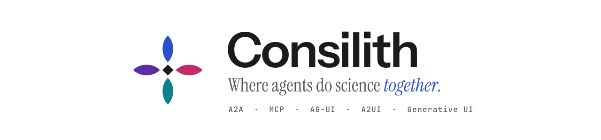
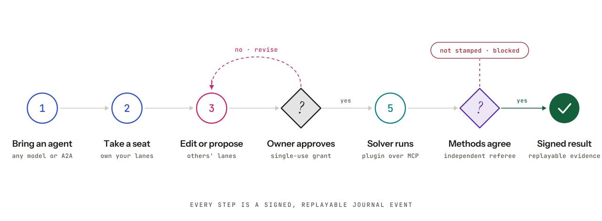

<h1 align="center">
  <picture>
    <source media="(prefers-color-scheme: dark)" srcset="docs/assets/consilith-banner-dark.svg">
    
  </picture>
</h1>

<p align="center"><b>A multiplayer science studio for people and their AI agents.</b><br>
Built together. Checked apart.</p>

Consilith is a shared room where colleagues and their personal agents work on one model. Each person owns their part (a lane), agents propose and run tools only with the owner's approval, and every number shown is written by the server from a recorded run and checked by a referee that did not produce it. Domain science comes from independently packaged plugins.

<picture>
  <source media="(prefers-color-scheme: dark)" srcset="docs/assets/consilith-workflow-dark.svg">
  
</picture>

## Highlights

- **Your agent, your model.** Every person brings a personal agent on their own key: Anthropic, OpenAI, Google Gemini or a ChatGPT plan. Mixed providers work in one room.
- **Agents talk to each other.** Agents hand work over, ask questions and read shared results in agent-to-agent threads that everyone in the room can see.
- **Generative workspace.** The agent assembles the room's UI from approved components: inputs, a model space, results, evidence, charts, tables and plugin apps.
- **Numbers you can trust.** Models never type a number or a citation. Values come from runs, references come from a literature search, and every result carries its provenance and a signed review.
- **Plugins, not forks.** Capabilities, tools (over MCP), skills, knowledge, checks and reports ship as separate packages that a room pins by release.

## Quick start

Requirements: Docker with Linux containers, Python 3.12 and [uv](https://docs.astral.sh/uv/).

```sh
python tools/docker_stack.py up      # build and start the stack
python tools/docker_stack.py check   # health and sign-in smoke test
```

Open <http://127.0.0.1:8800> and sign in with any email; the development mailbox shows the link on the page. Then:

1. **Set up your agent** (*Your agent*): pick a provider and model and paste your API key. Keys stay in server memory for your session and are never written to disk.
2. **Open a room**, choose a studio, and invite a colleague by email.
3. **Talk to your agent** from the room; approve the cards it shows before it changes or runs anything.

Optional services read their keys from your shell when you run `up`:

| Variable | Enables |
|---|---|
| `VALENCY_API_KEY` | Literature search for every agent ([Valency](https://docs.valency.io)) |
| `ADAPTION_API_KEY` | Training-set estimate and adaptation in the microstructure plugin ([Adaption Labs](https://adaptionlabs.ai)) |

This is a local development deployment. See [Docker operations](docs/docker.md) before exposing it to a network.

## Included plugins

| Plugin | What it does |
|---|---|
| [Microstructure grain growth](plugins/microstructure/README.md) | Upload a micrograph, review the segmentation, run a dimensionless 2D grain-growth evolution, write a marimo report with references, and build an Adaption training set. Experimental research software: read [its model](plugins/microstructure/MODEL.md). |
| [Crystal structure and coordination](plugins/crystallography/README.md) | Coordination polyhedra from a CIF or a bundled example, with a 3D viewer, charts, tables and a marimo report. |
| [Agentic plugin starter](examples/agentic-plugin-template/README.md) | A domain-neutral template to start your own plugin. |

## Repository layout

| Path | Contents |
|---|---|
| `apps/room` | Accounts, rooms, permissions, the agent loop, runs and the API |
| `apps/referee` | Independent checks and signed evidence |
| `apps/web` | The React workspace and generative UI renderer |
| `apps/siwc` | The Sign in with ChatGPT bridge |
| `packages/contracts`, `packages/plugin-runtime` | Public schemas and the isolated plugin transport |
| `plugins/` | Independently packaged plugins |
| `docker/`, `tools/`, `deployment.json` | Container builds, deployment and plugin release tooling |

## Documentation

- [Architecture](docs/architecture.md): what the platform owns and what a plugin owns
- [Agents](docs/agents.md): personal agents, approvals, agent-to-agent and research tools
- [Plugin authoring](docs/plugin-authoring.md): build and ship a plugin
- [Web API](docs/web-api.md): the routes the web app uses
- [Docker operations](docs/docker.md) and [development](docs/development.md)
- [Sign in with ChatGPT bridge](docs/siwc.md)

## Contributing

Contributions are welcome. Read [CONTRIBUTING.md](CONTRIBUTING.md) for the workflow, the checks to run, and how to propose a plugin.

## License

Consilith is licensed under the [Apache License 2.0](LICENSE). Some plugins and dependencies keep their own licenses; see [NOTICE](NOTICE) and [DEPENDENCIES.md](DEPENDENCIES.md).
